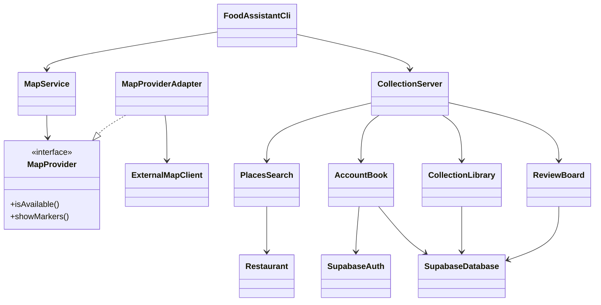

# Stage 2 Implementation Report

**Project:** Personal food assistant (EECS3311)  
**File status:** Working draft, 8 November 2026. This describes the code in the repository on that date. Sections marked **To finish** will be completed after the remaining features run.  
**Submission name:** Export this document to PDF or Word and commit it as `stage2-report` before the deadline.

---

## 1. Project overview and implementation status

The application is a personal food assistant. A signed-in person searches for restaurants near their location, sees them on a map, saves them into collections, writes reviews with photos and tags, and reads reviews written by friends.

The website and the command line share restaurant search. The Java server is the only program that talks to Google Places.

- The **GUI** is the website in `web/`. A Google Map fills the screen. Search calls `/api/search` on the Java server (`foodassistant.server.CollectionServer`, port 8080), which calls Places API (New). Accounts, collections, and reviews are stored through that same server. Account passwords go through Supabase Auth. Collections, reviews, friend links, and profile photos go through the Supabase database described in `supabase/schema.sql`.
- The **CLI** is `foodassistant.cli.FoodAssistantCli`. It calls the same `/api/search` route and prints the restaurants through `MapService`. It does not sign in, save collections, or call an LLM. The server must already be running.

**What works today**

- Interactive map with the user’s location, or downtown Toronto if location is denied.
- Restaurant search, result list, map pins, and a detail card.
- Sign-in, registration, password recovery, and profile edits.
- Per-account collections, including the default list **Saved restaurants**.
- Reviews with a 1–5 rating, a note, up to eight tags, and up to four photos.
- Friend requests and a chronological feed of friends’ reviews.

**What is not working yet**

- No LLM is connected. The chat card accepts typing and does not send a request.
- There is no food agent, no constraint extraction, no ranking strategy, and no recommendation history.
- Taste interests are a list the user types. They are stored in the browser and are not used to recommend anything.
- The “For you” sidebar button has no action.
- A bookmark on a friend’s post only changes the icon on that card. It does not save the restaurant.
- Reviews have no private/public choice. Every stored review can appear on a friend’s feed.
- The CLI does not exercise the features the website stores in Supabase.
- No feature demonstration videos have been recorded.

Login, logout, and password change are supporting behavior. They are not counted toward the ten features.

---

## 2. Feature-to-implementation mapping

Each entry accounts for a Stage 1 feature. “How it runs” describes only the path that exists in the current code.

### F01 — Personal Food Map Visualization

| Field | Current contents |
| --- | --- |
| Stage 1 reference | F01 |
| Status | Modified. The map runs. Saved and searched places can appear as pins. Visited places and AI recommendations do not. |
| Classes and files | GUI: `web/src/components/MapBackground.tsx` draws the Google Map, the user pin, and restaurant pins. `web/src/App.tsx` chooses which places are on the map: search results while a query is active, otherwise the open collection. `web/src/components/PlaceDetail.tsx` is the detail card. `web/src/userLocation.ts` reads the browser location. Search: `PlacesSearch` on the server, called by `/api/search`. CLI display: `MapService`, `MapProvider`, `MapProviderAdapter`, `ExternalMapClient`, `Restaurant`, `Location`. |
| Key methods | `PlacesSearch.search()`, `MapService.show()`, `MapProviderAdapter.showMarkers()`, `ExternalMapClient.renderPins()`. |
| Design patterns | Adapter, on the CLI path only. |
| Video | To finish. |

**How the classes collaborate.** On the website, the user opens the page. `useUserLocation` asks the browser for a position. `MapBackground` centers the map on that position, or on Toronto. If the user is browsing a collection, `App` passes that collection’s places to the map. Selecting a pin opens `PlaceDetail`. A restaurant with no coordinates is still listed, but it is not pinned. Search results come from `/api/search`. On the CLI, `FoodAssistantCli` calls that same route, then `MapService.show()` displays the list. `MapProviderAdapter` turns each `Restaurant` into a pin label and `ExternalMapClient` prints it. If the CLI is started with `--unavailable`, the adapter reports the map as down and `MapService` prints a list instead.

**Type:** Hybrid in the Stage 1 design. The running map and filter are deterministic. No AI recommendations are drawn.

**Still missing:** a visited layer, recommended pins, and collection layers that can be toggled together. Search is shared. The command line still does not save collections or write reviews.

### F02 — Personal Reviewing and Logging

| Field | Current contents |
| --- | --- |
| Stage 1 reference | F02 |
| Status | Modified. A signed-in user can create, edit, and delete a review. The review is not added to an AI memory, and the user cannot mark it private. |
| Classes and files | `ReviewPanel.tsx` and `PhotoFramer.tsx` collect the rating, note, tags, and photos. `web/src/reviews.ts` calls `/api/reviews`. `ReviewBoard` checks the input. `Review` holds one review. `ReviewPhotos` packs up to four images into the stored photo field. `SupabaseDatabase` reads and writes the `reviews` table. |
| Key methods | `ReviewBoard.publish()`, `ReviewBoard.update()`, `ReviewBoard.delete()`, `ReviewBoard.latest()`, `ReviewPhotos.encode()`, `ReviewPhotos.decode()`. |
| Design patterns | None of the five Stage 1 patterns. Stage 1 attached Observer here so a new review would update taste and memory. That notifier is not in the code. |
| Video | To finish. |

**How the classes collaborate.** The user opens Create, picks a restaurant, sets one to five stars, writes a note, and may add tags and photos. `ReviewPanel` sends that body to the Java server. `ReviewBoard` rejects a missing restaurant, a rating outside 1–5, an empty note, a note over 500 characters, more than eight tags, or a photo that is too large. A valid review is inserted in Supabase for that account. Editing loads the same record and sends it back through `update`. Deleting removes that row only.

**Type:** Deterministic today. Stage 1 called it hybrid because the stored review was supposed to become food memory. That step does not exist.

### F03 — Conversational AI Recommendation Assistant

| Field | Current contents |
| --- | --- |
| Stage 1 reference | F03 |
| Status | Not implemented. |
| Classes and files | `web/src/components/ChatCard.tsx` is the visible chat card. The send button does not call a server. Stage 1 classes `FoodAgent`, `ConstraintExtractor`, `CandidateFilter`, `RestaurantService`, `MemoryService`, `RankingStrategy`, `LLMEngine`, and `LLMFactory` are not in the source tree. |
| Key methods | None. |
| Design patterns | Facade, Strategy, Factory Method, and Adapter were planned. None of them exist for this feature yet. |
| Video | To finish, after the feature runs. |

**How it was supposed to run.** The user types a sentence. The agent extracts cuisine, place, budget, and similar constraints, loads restaurants and the user’s taste, filters, ranks, and returns a short reason plus map pins. That workflow is still the Stage 1 design.

**Type:** AI-based, once it is built.

### F04 — Personalized Taste Profile

| Field | Current contents |
| --- | --- |
| Stage 1 reference | F04 |
| Status | Not implemented as specified. A small explicit-interest list exists and does not affect recommendations. |
| Classes and files | `web/src/components/AccountPanel.tsx` lets the user type food interests and a short description. `web/src/profileExtra.ts` stores them in the browser under `food-assistant-profile:<accountId>`. `web/src/foodInterests.ts` matches a typed word to a fixed cuisine list with edit distance. Nothing on the server reads this list. |
| Key methods | `readProfileExtra()`, `writeProfileExtra()`. There is no `TasteProfileUpdater` or `MemoryService`. |
| Design patterns | Observer was planned. It is not implemented. |
| Video | To finish. |

**Type:** Stage 1 marked this AI-based. The current list is deterministic and local to one browser.

### F05 — Quick Photo Experience Sharing

| Field | Current contents |
| --- | --- |
| Stage 1 reference | F05 |
| Status | Not implemented. Photos can be attached only inside a full review (F02). There is no separate “take a photo and post it” action. |
| Classes and files | `PhotoFramer.tsx` crops a review photo. `ReviewPhotos` stores it. The image button on `ChatCard` does nothing. |
| Key methods | `ReviewPhotos.encode()`. |
| Design patterns | N/A |
| Video | To finish, or record the replacement if this feature is folded into F02. |

**Type:** Planned as hybrid. Not running as its own feature.

### F06 — Friends’ Activity Feed

| Field | Current contents |
| --- | --- |
| Stage 1 reference | F06 |
| Status | Modified. Friends and the feed work. Saving a friend’s restaurant to the user’s own map does not. |
| Classes and files | `FriendsPanel.tsx` is the feed and the add-friend screen. `AccountBook` looks up an account by email, sends and answers friend requests, and builds the feed. `FriendStore` keeps requests in the Supabase `friendships` table. `AvatarStore` keeps profile photos in the Supabase `avatars` table. `SupabaseDatabase.publicReviews()` loads each friend’s reviews. |
| Key methods | `AccountBook.lookupFriend()`, `requestFriend()`, `respond()`, `cancelRequest()`, `circle()`. `FriendStore.request()`, `accept()`, `reject()`, `cancel()`, `friendIds()`. |
| Design patterns | N/A |
| Video | To finish. |

**How the classes collaborate.** A signed-in user searches by email. `AccountBook.lookupFriend` finds the other account and `requestFriend` records an outgoing request in `FriendStore`. The other person accepts or declines through `respond`. `circle()` then loads each friend’s reviews from Supabase, sorts them by time, and `FriendsPanel` shows the author, stars, tags, note, and photos. If there are no friends, the panel explains that the feed is empty. The bookmark button on a post only flips local component state. It does not call `CollectionLibrary`.

**Type:** Deterministic. Stage 1 also wanted the feed to inform later recommendations. That link is not built.

### F07 — Restaurant Discovery and Search

| Field | Current contents |
| --- | --- |
| Stage 1 reference | F07 |
| Status | Implemented. The website and the command line both call `/api/search`. |
| Classes and files | `SearchBar.tsx` takes the query. `web/src/places.ts` calls `/api/search`. `PlacesSearch` calls Places API (New), biased to the user or to Toronto, and maps each place into a `Restaurant`. `RestaurantCard.tsx` renders a result. `FoodAssistantCli` calls the same route and `MapService` prints it. |
| Key methods | `searchRestaurants()` in `places.ts`. `PlacesSearch.search()`. `MapService.show()`. |
| Design patterns | Adapter, on the CLI display path. The website asks the Java server and does not call Places itself. |
| Video | To finish. |

**How it runs.** After two characters, the website waits briefly and calls `/api/search` with the text and the user’s location, or downtown Toronto. The server asks Places and returns the matches. They appear in a list and as amber pins. Choosing one closes the list, centers that pin, and opens the detail card. If Places fails, the list shows the server’s error. The command line uses the same route: `java -cp out foodassistant.cli.FoodAssistantCli --query ramen --cuisine Japanese`.

**Type:** Deterministic.

### F08 — Restaurant Recommendation History

| Field | Current contents |
| --- | --- |
| Stage 1 reference | F08 |
| Status | Not implemented. No recommendation is generated, so nothing is stored to revisit. |
| Classes and files | Stage 1 named `HistoryRecorder`. That class is not in the repository. |
| Key methods | None. |
| Design patterns | Observer was planned for recording history after feedback. Not implemented. |
| Video | To finish. |

**Type:** Planned as hybrid.

### F09 — Automatic Category Tagging

| Field | Current contents |
| --- | --- |
| Stage 1 reference | F09 |
| Status | Not implemented. Tags are typed by the user. |
| Classes and files | `ReviewPanel.tsx` accepts up to eight tags, each at most 24 characters. `foodInterests.ts` only corrects profile interests against a fixed list. No model suggests restaurant categories. |
| Key methods | Tag checks inside `ReviewBoard.review()`. |
| Design patterns | N/A |
| Video | To finish. |

**Type:** Planned as AI-based or hybrid. Current tagging is deterministic and manual.

### F10 — Save and Custom Food Collections

| Field | Current contents |
| --- | --- |
| Stage 1 reference | F10 |
| Status | Implemented, with one gap: a collection is not a toggleable map layer independent of the open list. Opening Saved, or one named collection, is what puts those places on the map. |
| Classes and files | `CollectionsPanel.tsx` and `CollectionMenu.tsx` are the screens. `web/src/collections.ts` calls `/api/collections`. `CollectionLibrary` creates, fills, and deletes lists. `Collection` is one list. `CollectionStore` loads the library for the signed-in account. Rows live in the Supabase `collections` and `places` tables. |
| Key methods | `CollectionLibrary.create()`, `addPlace()`, `removePlace()`, `delete()`, `all()`. `Collection.add()`, `Collection.remove()`. The default list is `Collection.saved()` (“Saved restaurants”), and `delete` refuses to remove it. |
| Design patterns | N/A |
| Video | To finish. |

**How the classes collaborate.** After sign-in, the server loads that account’s collections. If none exist, it creates Saved restaurants. The bookmark on a place detail opens `CollectionMenu`. Choosing a list calls `addPlace` or `removePlace`. A duplicate restaurant is not added twice. Creating a list asks for a name and rejects a blank or repeated name. Deleting a custom list removes the list. The restaurant can still sit in Saved or in another list. An empty custom list is allowed.

**Type:** Deterministic. Stage 1 also said the agent could read collections later. The agent does not exist yet.

---

## 3. Implemented design patterns

Stage 1 required five patterns: Facade, Strategy, Factory Method, Observer, and Adapter. **Only Adapter is in the code today.** The other four are still the Stage 1 design. They will be written into this section when the agent exists. Naming them here would not match the submitted program.

### Adapter — implemented

- **Problem.** `MapService` needs to show pins. The external map client does not accept `Restaurant` objects. It accepts plain text labels and has its own availability check.
- **Roles.** `MapProvider` is the interface the application expects (`isAvailable`, `showMarkers`). `MapProviderAdapter` is the adapter. `ExternalMapClient` is the adaptee (`ping`, `renderPins`).
- **Files and methods.** `src/main/java/foodassistant/map/MapProvider.java`, `MapProviderAdapter.java`, `ExternalMapClient.java`. `FoodAssistantCli` builds `new MapService(repository, new MapProviderAdapter(client), System.out)`.
- **Why it matches the pattern.** `MapService` depends on `MapProvider` only. The adapter translates each restaurant into a label such as the pin text plus coordinates, then calls `renderPins`. A second map client could implement `MapProvider` without a change to `MapService`.
- **Stage 1.** This is the same Adapter planned for the map. Stage 1 also planned an adapter in front of each LLM. That second adapter is not written.
- **Limit.** The website’s live Google Map does not use this adapter. The browser calls the Maps and Places APIs itself.

### Facade, Strategy, Factory Method, Observer — not in the source yet

| Pattern | Stage 1 problem | Planned participants | Current state |
| --- | --- | --- | --- |
| Facade | One call should run extract, retrieve, filter, rank, and explain. | `FoodAgent` in front of the recommendation steps. | Not in the source. |
| Strategy | Ranking by taste and ranking by distance should be interchangeable. | `RankingStrategy`, `TasteBasedRanking`, `DistanceBasedRanking`. | Not in the source. |
| Factory Method | The app should construct a local model or a cloud model from configuration. | `LLMFactory`, `LLMEngine`, `LocalLLMEngine`, `OpenAILLMEngine`. | Not in the source. |
| Observer | A review or a like should update taste and history without the agent calling each one. | `FeedbackPublisher`, `FeedbackObserver`, `TasteProfileUpdater`, `HistoryRecorder`. | Not in the source. |

### Diagrams

The Stage 1 drawings are still in the repository:

- `Stage1-ClassD.uxf`
- `Stage1-UC.uxf`
- `Stage1-SD.uxf`

They are no longer an accurate picture of the running program. They include `FoodAgent` and the four patterns above, and they do not include `CollectionServer`, `AccountBook`, `ReviewBoard`, or Supabase. An updated UML class diagram, and updated use-case and sequence diagrams for the features that changed, will be added when the implementation is complete. **To finish.**

The sketch below is only a map of the code that exists now. It is not the UML submission.

---

## 4. Changes and rationale

These are the differences already visible between the Stage 1 design and the code. Later changes, especially anything that replaces F03, F05, or a pattern, will be added in the same four-part form.

**Restaurant search on the website**

- Original design: `RestaurantService` and `RestaurantRepository` search a project data source, and the map adapter displays the hits.
- Implemented change: `PlacesSearch` calls Places API (New). The website and the command line both call `/api/search`. There is no local restaurant file.
- Reason: a live map needs current restaurant names and coordinates, and both programs need the same results.
- Impact: F07 works for real places. F01 pins those places. The server key lives in `supabase.local` as `PLACES_API_KEY`. A browser-restricted Maps key cannot call Places from Java.

**Accounts and storage**

- Original design: a `User` owns memories, collections, and reviews. The design did not specify a database.
- Implemented change: sign-in uses Supabase Auth (`SupabaseAuth`). Collections and reviews are rows in Supabase (`SupabaseDatabase`). Friend links and avatars are JSON files on the machine that runs the Java server.
- Reason: each person needs their own lists and reviews, and passwords cannot be stored in the website.
- Impact: F02, F06, and F10 survive a browser refresh and a server restart. Profile interests also stay in that browser only.

**Review privacy**

- Original design: the user chooses whether a review is private or public.
- Implemented change: there is no visibility field. `publicReviews()` returns every review of that account, and the feed shows them to friends.
- Reason: the first stored review only needed rating, text, tags, and photos.
- Impact: F06 can show friends’ reviews. F02 does not yet meet the private-or-public choice. This has to be a real field before the feature is called complete, or the report must record a deliberate replacement.

**Quick photo post**

- Original design: F05 publishes a photo, an optional restaurant, and a short note without a full review.
- Implemented change: photos exist only as part of a review.
- Reason: the review screen was built first.
- Impact: F05 is still outstanding. It can be built as its own post, or replaced with a written explanation that review photos cover the same user need. That decision is **to finish**.

**Friends bookmark**

- Original design: from a friend’s post, the user saves that restaurant onto their own map.
- Implemented change: the bookmark flips a local React flag and forgets it on the next load.
- Reason: the feed display was connected before the save action.
- Impact: F06’s main viewing path works. The save path does not and should be wired to `CollectionLibrary`.

**Chat and agent**

- Original design: F03 is the facade over extraction, memory, search, ranking, and an LLM explanation.
- Implemented change: the chat card is layout only.
- Reason: map, accounts, collections, reviews, and friends were built first.
- Impact: F03, F04’s learning loop, F08, and F09 are blocked on this work. Facade, Strategy, Factory Method, and Observer are blocked with it. The minimum of five patterns is not met yet.

**CLI scope**

- Original design: the CLI reaches the agent’s major functions.
- Implemented change: the CLI only loads the sample map.
- Reason: the first Java slice was restaurant search and the adapter.
- Impact: a reviewer can run a command-line map, but cannot review, save, or ask for a recommendation from the terminal. Those commands are **to finish**.

---

## 5. AI tools and collaboration log

Using an AI tool is required, and this draft was written with one. The cost line is intentionally blank until the usage page is copied in. Do not paste API keys, chat transcripts that contain keys, or `.env` contents into this section.

| Tool or platform | Model | What it was used for | Token cost | Money cost |
| --- | --- | --- | --- | --- |
| Cursor | Grok 4.7, in the sessions that produced the current GUI, Java server, and this draft | Map UI, Places search, collections, reviews, friends, Supabase wiring, and this report draft | To finish | To finish |

**Representative interactions.** To finish: paste or summarize a few real exchanges that show the tool proposing code and the author checking it. Good candidates are the Places search hookup, the review validation rules, and the friends feed. Each summary should name the feature or class and what was kept or changed after review.

No LLM API key is used by the application yet. When one is added, it stays in an untracked local file. This report will not contain the key.

---

## 6. Development and verification summary

### Weekly commits

The Stage 2 window is 20 October 2026 through 10 November 2026. Counts below are commits that change the program, from `git log` on 8 November 2026. Report-only commits are not included. Links use the GitHub repository `https://github.com/Melliee1126/EECS3311-Course-Project`.

| Period | Meaningful code commits | Links |
| --- | --- | --- |
| 20 Oct – 26 Oct 2026 | None during this week. | — |
| 27 Oct – 2 Nov 2026 | None during this week. | — |
| 3 Nov – 9 Nov 2026 | Two. `f65a7c8` (3 Nov) adds the map website shell and the first Java restaurant search. `525a84c` (5 Nov) adds Google Places search, signed-in collections, and reviews stored in Supabase. | https://github.com/Melliee1126/EECS3311-Course-Project/commit/f65a7c8 · https://github.com/Melliee1126/EECS3311-Course-Project/commit/525a84c |
| 10 Nov 2026 | To finish if more implementation lands on the due date. | To finish |

Earlier history is Stage 1 material: `61278de` on 30 September 2026 and `2e3be5c` on 9 October 2026. Those dates are outside the Stage 2 window.

The empty weeks do not meet the weekly-commit expectation. Further implementation should be committed during the week it is written, with a message that says what behavior changed.

### Checks already exercised

There is no automated test suite. Checks so far are manual:

- CLI: with the Java server running, `FoodAssistantCli --query ramen` prints the same Places results the website uses. `--unavailable` prints a list instead of pin lines.
- GUI: with a Maps key in `web/.env.local`, search returns Places results, pins, and a detail card. Without a key, the page explains that the key is missing.
- A signed-in account can create a collection, add and remove a place, and keep Saved restaurants. The Java server must be running and `supabase/schema.sql` must already have been applied.
- A review with a bad rating or an empty note is rejected by `ReviewBoard`. A valid review is stored and listed.
- Two accounts can request and accept a friendship, and the feed lists the friend’s reviews.

### Defects corrected along the way

To finish. Add the specific bugs that were found and fixed, with the commit that fixed each one, rather than a general statement.

### Remaining limitations

- No LLM, agent, ranking, recommendation history, or automatic tags.
- One of five design patterns is present.
- The command line searches through the server. It still does not sign in, save a collection, or write a review.
- Friend links and avatars are local files. Profile interests are in `localStorage`.
- Friend-post bookmarks are not saved.
- Reviews cannot be marked private.
- The “For you” control does nothing.
- Videos and the updated UML are not done.

---

## 7. Demonstration index

No recordings exist yet. Every implemented feature still needs a clip that shows the real GUI or CLI, the input, the output, and any error path. Slides will not replace that. The table is the index to fill. Timestamps can point into one combined video or into separate files. Links must open without an access request, and the recordings must not show API keys.

| Feature | What the clip needs to show | Link and timestamp |
| --- | --- | --- |
| F01 Personal food map | Open the site, show the user pin or the Toronto fallback, open a collection so its places appear, select a pin. Separately, run the CLI and show the list fallback with `--unavailable`. | To finish |
| F02 Reviews | Create a review with stars, a note, tags, and a photo. Show it stored. Show a rejected empty note or missing rating. | To finish |
| F03 Recommendation assistant | Not recordable until the agent answers a real request and the result appears in the app. | To finish |
| F04 Taste profile | Not recordable until the profile is actually updated from use and then used. The current interest list can be shown only if the report still calls the feature unfinished. | To finish |
| F05 Quick photo | Not recordable until a photo post exists apart from a full review, or until a replacement is documented in section 4. | To finish |
| F06 Friends feed | Send a request, accept it, and show the friend’s review on the feed. Include the empty-feed state. The save-to-my-map action should be recorded after it really saves. | To finish |
| F07 Search | Type a query, show the list and the pins, open one place. Show the message when Places cannot be reached. | To finish |
| F08 Recommendation history | Not recordable until recommendations are stored and reopened. | To finish |
| F09 Automatic tags | Not recordable until tags are suggested, then corrected by the user. | To finish |
| F10 Collections | Create a named list, add a restaurant, show it on the map, refuse a duplicate, delete the custom list, and show that Saved restaurants remains. | To finish |

Together, the finished recordings have to show both the website and the CLI.
